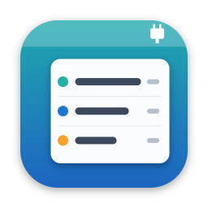

<h1 align="center">USBMenu</h1>

A quick menu bar shortcut to see every connected USB device and copy its details.

---

USBMenu puts a live list of your Mac's USB devices in the menu bar. Plug something in or unplug it and the list updates instantly. No refresh button, no digging through System Information.

## Features

- **Live list.** Every connected USB device, updated the moment it's plugged in or removed, with a device count in the menu bar.
- **Every detail, one click to copy.** Name, vendor, VID:PID, serial number, serial port (like `/dev/cu.usbmodem2101`) and USB location.
- **Knows your boards.** Names popular maker boards (Arduino, ESP32 with native USB, Teensy, Raspberry Pi RP2040, Adafruit, SparkFun, Seeed, ST-LINK) and the USB-serial chips on clones and ESP32/ESP8266 boards (CH340, CH9102, CP210x, FTDI, PL2303).
- **IP addresses for USB network devices.** USB Ethernet adapters, tethered phones and boards in USB gadget mode show their interface and IP.
- **Stays out of the way.** Menu bar only, no Dock icon. USB hubs hidden by default. Optional Launch at Login.
- **Private.** Runs entirely on your Mac. No data collected, no internet connection.

## Requirements

macOS 12 Monterey or later. Launch at Login needs macOS 13 or later.

## Help

See the [support page](https://rauls4.github.io/usbmenu/) for common questions, or email [raul@silvadesign.com](mailto:raul@silvadesign.com).

To get a board recognized by name, send its VID:PID (shown in the device's submenu).

## Privacy

USBMenu doesn't collect, store or share any data. Read the [privacy policy](https://rauls4.github.io/usbmenu/privacy.html).

---

© 2026 Raul Silva. All rights reserved. See [LICENSE](LICENSE).
